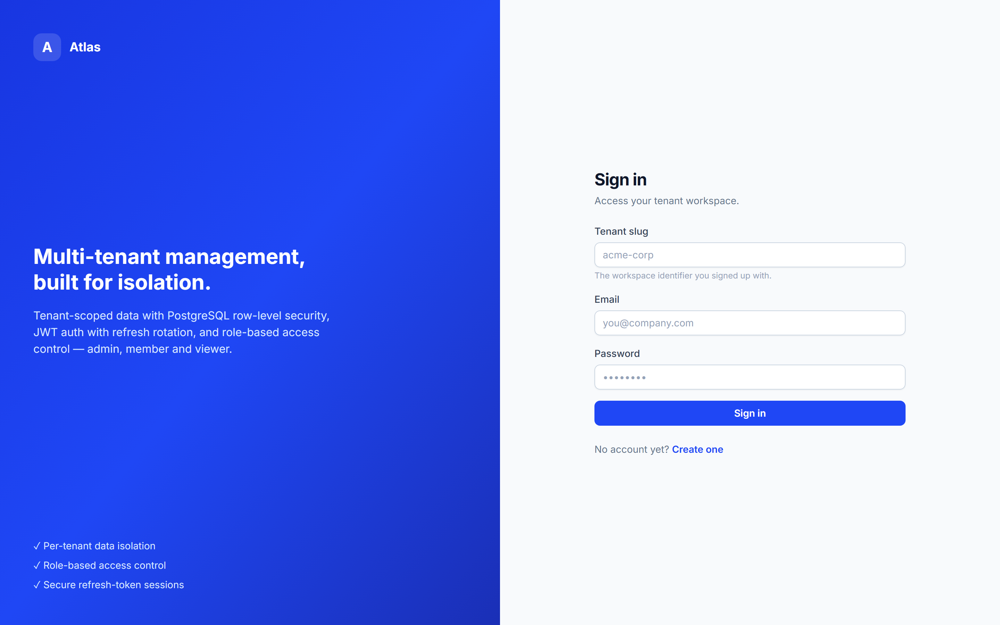
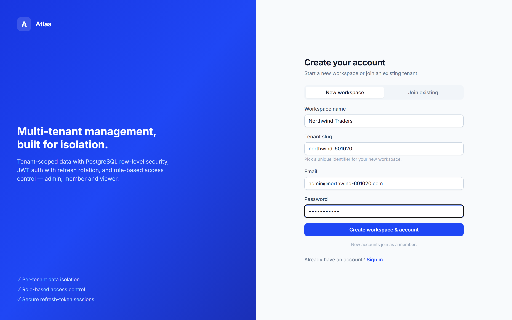
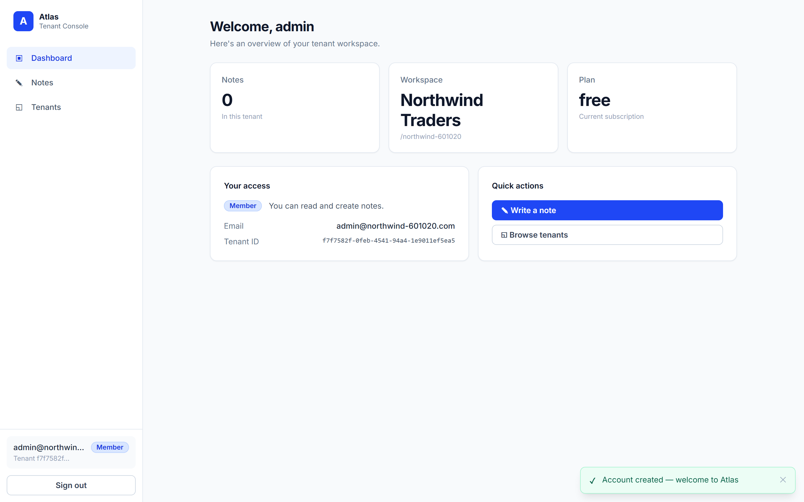
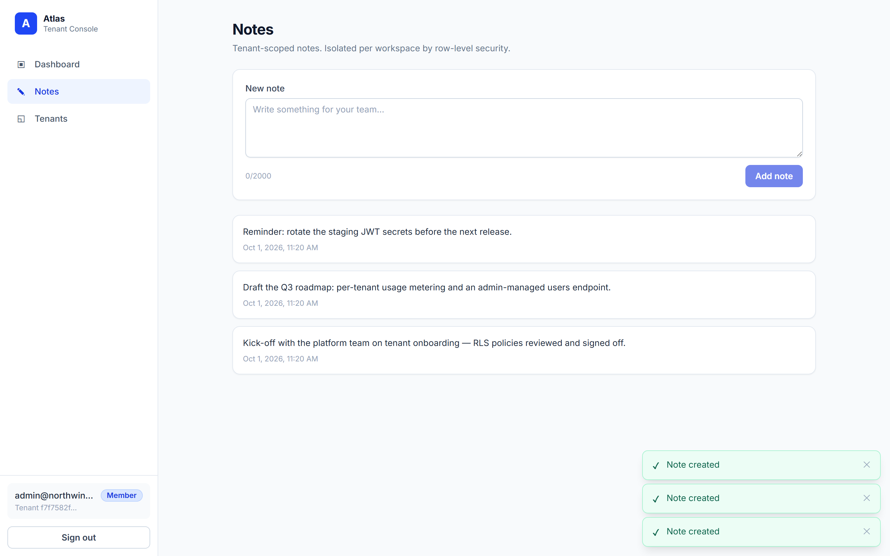
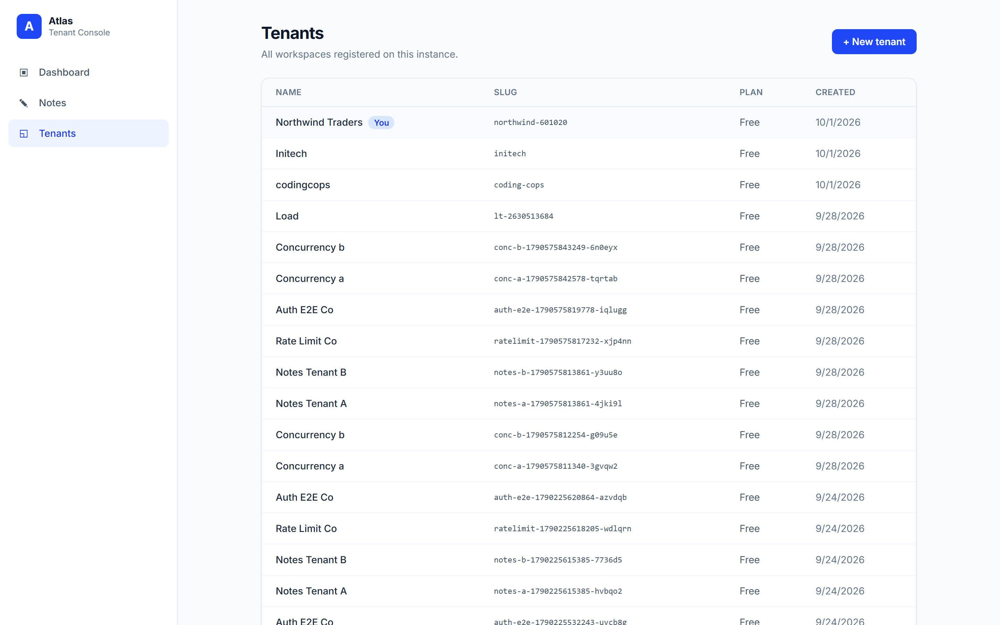

# Multi-Tenant Management — Frontend

A React admin console for the [Multi-Tenant Management Backend](https://github.com/Moon-Khan/Multi-Tenant-Management-Backend).
Built with **Vite + React + TypeScript + Tailwind CSS**.

It talks to the NestJS API over HTTP and demonstrates the backend's core
features end to end: tenant-scoped auth, JWT access tokens with httpOnly
refresh-cookie sessions, and role-based access control (admin / member / viewer).

## Screenshots

### Sign in
Tenant-scoped login — the workspace slug, email and password are sent with the
`x-tenant-slug` header the backend requires before a JWT exists.



### Create account / workspace
Register a brand-new workspace (via the public `POST /tenants`) or join an
existing tenant, then auto sign-in.



### Dashboard
An overview of the tenant: notes count, workspace, plan, and the signed-in
user's role and capabilities.



### Notes
Tenant-scoped notes, isolated per workspace by PostgreSQL row-level security.
Admin/member can write; viewers get a read-only view.



### Tenants
Every workspace registered on the instance; the signed-in user's own tenant is
flagged, and new tenants can be created inline.



## Features

- **Tenant-scoped login & registration** — sends the `x-tenant-slug` header the
  backend expects before a JWT exists.
- **Create a new workspace** on sign-up (via the public `POST /tenants`) or join
  an existing tenant.
- **Persistent sessions** — the access token is kept in memory only; on reload
  the session is restored from the httpOnly refresh cookie via `POST /auth/refresh`.
- **Silent token refresh** — a single-flight axios interceptor refreshes the
  access token on a `401` and retries the original request.
- **RBAC-aware UI** — viewers get a read-only notes view; admin/member can write.
- **Pages**: Dashboard, Notes, Tenants, plus Login / Register and a 404.

## Prerequisites

- Node.js 18+
- The backend running and reachable (default `http://localhost:3000`).
  Make sure the backend's `CORS_ORIGIN` includes this app's origin
  (`http://localhost:5173` by default) — it does out of the box.

## Getting started

```bash
cp .env.example .env   # adjust VITE_API_URL if your API isn't on :3000
npm install
npm run dev            # http://localhost:5173
```

Build for production:

```bash
npm run build
npm run preview
```

## Configuration

| Variable       | Default                 | Description                 |
| -------------- | ----------------------- | --------------------------- |
| `VITE_API_URL` | `http://localhost:3000` | Base URL of the backend API |

## How it maps to the API

| UI               | Endpoint(s)                                             |
| ---------------- | ------------------------------------------------------ |
| Login            | `POST /auth/login` (+ `x-tenant-slug`)                 |
| Register         | `POST /tenants` (optional) → `POST /auth/register` → login |
| Session restore  | `POST /auth/refresh`, `GET /auth/me`                   |
| Sign out         | `POST /auth/logout`                                    |
| Notes            | `GET /tenant-notes`, `POST /tenant-notes` (admin/member) |
| Tenants          | `GET /tenants`, `POST /tenants`                        |

Every response is unwrapped from the backend's `{ status, msg, data }` envelope
in [`src/lib/services.ts`](src/lib/services.ts).

## Project structure

```
src/
├── components/   # Layout, AuthShell, ProtectedRoute, UI bits
├── context/      # AuthContext (session), ToastContext (notifications)
├── lib/          # axios instance + interceptors, typed services, types
├── pages/        # Login, Register, Dashboard, Notes, Tenants, NotFound
├── App.tsx       # routes
└── main.tsx      # providers + entry
```

## Branching & feature history

This repo was built feature-by-feature; each feature lived on its own branch and
was merged into `main` with a merge commit:

- `feature/auth` — tenant-scoped login, registration and sessions
- `feature/dashboard` — app shell with sidebar nav and the tenant overview
- `feature/notes` — tenant-scoped notes with role-based writes
- `feature/tenants` — tenant directory and workspace creation
- `feature/docs-and-screenshots` — this documentation and the screenshots above

```
git log --oneline --graph
```
